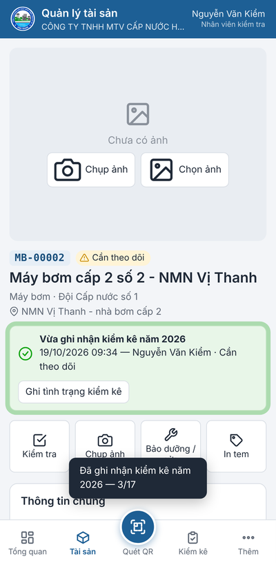
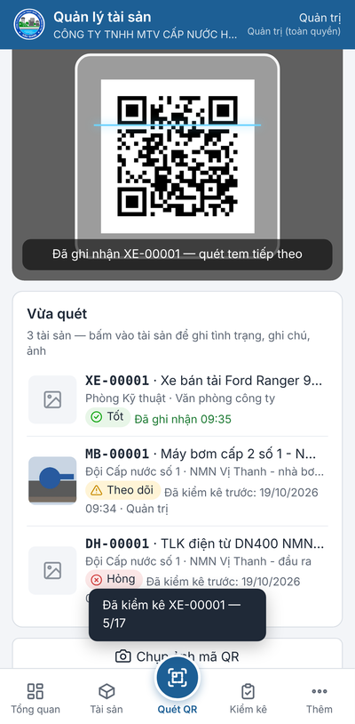
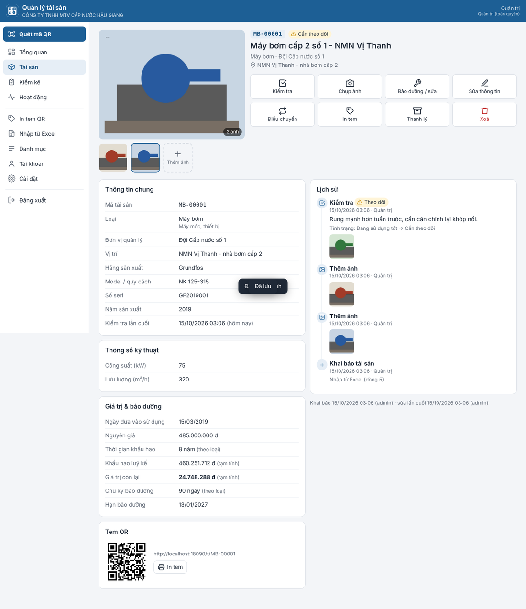
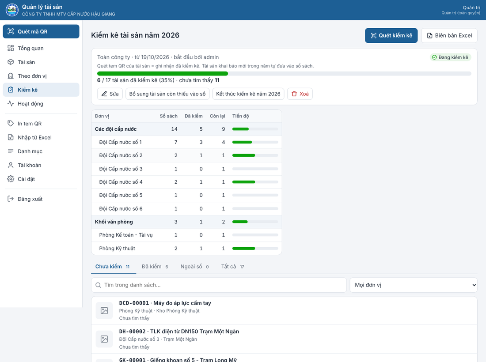
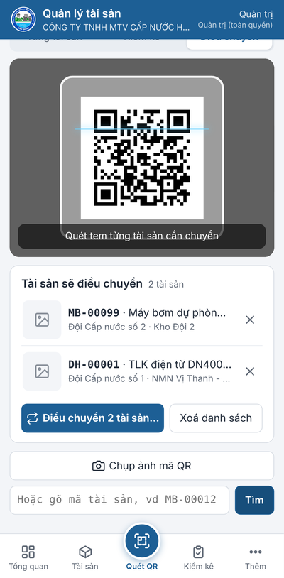
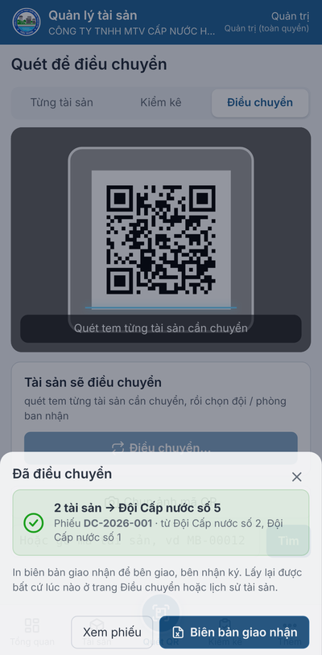

# Phần mềm Quản lý tài sản — quét tem QR xem thông tin, ảnh tài sản

Mỗi tài sản dán 1 tem QR. Quét tem bằng điện thoại → thấy ngay thông tin, ảnh, thông số kỹ thuật, lịch sử kiểm tra / sửa chữa;
ghi kiểm tra, báo hỏng, bảo dưỡng, chụp ảnh tại chỗ; **mỗi năm kiểm kê 1 lần — quét tem là ghi nhận đã kiểm kê**; in tem, nhập / xuất Excel.
Thiết kế chi tiết: [THIET_KE.md](THIET_KE.md).

| Điện thoại: quét tem → đã ghi nhận kiểm kê | Quét liên tục (kiểm kê) | Máy tính: trang tài sản |
|---|---|---|
|  |  |  |

Thêm: [đăng nhập](anh-man-hinh/dien-thoai-dang-nhap.png) · [theo đơn vị](anh-man-hinh/theo-don-vi.png) · [tổng quan](anh-man-hinh/tong-quan.png) · [in tem QR](anh-man-hinh/in-tem.png) · [trang tài sản trên điện thoại](anh-man-hinh/dien-thoai-tai-san.png) · [kiểm kê năm](anh-man-hinh/kiem-ke-nam.png) · [điều chuyển trên điện thoại](anh-man-hinh/dien-thoai-dieu-chuyen.png)

## Thư mục

| Tệp | Dùng để |
|---|---|
| `QuanLyTaiSan.exe` | chương trình (giao diện web nhúng sẵn); nhấp đúp để chạy thử trên 1 máy tính |
| `dist\quanlytaisan-may-chu-<phiên bản>.zip` | **gói cài máy chủ** (giống gói máy chủ HawaMap): chép lên máy chủ Windows → Extract All → nhấp đúp `CAI-DAT-MAY-CHU.bat` |
| `CAI-DAT-MAY-CHU.bat`, `trien-khai\` | trình cài đặt máy chủ IIS (hỏi - đáp), script IIS, đặt lại mật khẩu quản trị, sao lưu, gỡ cài đặt |
| `HUONG-DAN-CAI-DAT.html` (từ [`trien-khai/HUONG_DAN_MAY_CHU.md`](trien-khai/HUONG_DAN_MAY_CHU.md)) | hướng dẫn dựng máy chủ từng bước cho người mới |
| `src\`, `web\`, `tools\` | mã nguồn: máy chủ C#, giao diện web, công cụ đóng gói |
| `build.bat` | biên dịch lại trên Windows và tạo gói cài máy chủ trong `dist\` |

Cần .NET Framework 4.5 trở lên (có sẵn trong Windows 10/11, Windows Server 2016 trở lên).

## Chạy thử trên máy tính

1. Nhấp đúp `QuanLyTaiSan.exe`. Lần đầu cửa sổ đen hỏi **tên và mật khẩu quản trị** — gõ rồi Enter.
2. Trình duyệt tự mở `http://localhost:18090`. Đăng nhập. Dữ liệu nằm trong thư mục `DuLieu` cạnh file .exe.
3. Đóng cửa sổ đen là dừng phần mềm.

Chạy thử chỉ dùng trên chính máy đó. Để điện thoại quét được bằng camera trong trang web phải cài lên máy chủ IIS (có https).
(`QuanLyTaiSan.exe --lan` cho máy khác trong mạng nội bộ vào bằng http để xem thử — không mã hoá, camera trong trang không chạy.)

## Cài lên máy chủ (dùng thật) — giống máy chủ HawaMap

Cùng cách dựng với máy chủ bản đồ HawaMap: IIS + URL Rewrite + HttpPlatformHandler, tên miền riêng (vd `taisan.congty.vn`),
HTTPS miễn phí bằng win-acme (Let's Encrypt). Máy chủ đã chạy HawaMap thì cài thêm lên chính máy đó.

1. Chép `dist\quanlytaisan-may-chu-<phiên bản>.zip` lên máy chủ Windows → chuột phải → **Extract All**.
2. Nhấp đúp **`CAI-DAT-MAY-CHU.bat`** → trả lời từng câu (bật IIS, kiểm tra 2 module, tên miền, tài khoản quản trị của
   phần mềm, lịch sao lưu). Chạy lại tệp này để cập nhật phiên bản mới — dữ liệu giữ nguyên.
3. Bật HTTPS bằng win-acme rồi chạy lại `CAI-DAT-MAY-CHU.bat` (tự chuyển http → https).
4. Đăng nhập quản trị → **Cài đặt** → *Địa chỉ in trong mã QR* = `https://taisan.congty.vn` (trước khi in tem).

Từng bước chi tiết cho người mới (thuê VPS, Remote Desktop, trỏ tên miền, mở cổng, HTTPS, sao lưu, quên mật khẩu, xử lý
lỗi, chưa có tên miền, dùng chung máy chủ với HawaMap / Thất thoát nước): [`HUONG-DAN-CAI-DAT.html`](HUONG-DAN-CAI-DAT.html)
trong gói (bản Markdown: [`trien-khai/HUONG_DAN_MAY_CHU.md`](trien-khai/HUONG_DAN_MAY_CHU.md)).

## Bắt đầu sử dụng

1. **Danh mục**: đã có sẵn 13 loại tài sản của ngành nước (máy bơm, tủ điện – biến tần, máy phát, thiết bị xử lý nước, thuỷ lượng kế,
   van – trụ cứu hoả, đường ống, giếng khoan, nhà trạm – bể chứa, xe, thiết bị văn phòng, dụng cụ, khác) với tiền tố mã, số năm khấu hao,
   chu kỳ bảo dưỡng, thông số kỹ thuật riêng; và đơn vị quản lý chia 2 khối: **Các đội cấp nước** (Đội Cấp nước số 1–6) và
   **Khối văn phòng** (Ban Giám đốc, Phòng Tổ chức - Hành chính, Kế toán - Tài vụ, Kỹ thuật, Kinh doanh). Bấm vào dòng để sửa,
   thêm cho đúng thực tế công ty (khi thêm đơn vị chọn khối).
2. **Đưa tài sản vào**:
   - **Nhập từ Excel**: tải file mẫu, hoặc dùng luôn file sổ tài sản cố định đang có — phần mềm tự nhận các cột theo tiêu đề
     (Mã tài sản, Tên tài sản, Loại, Đơn vị, Vị trí, Hãng, Model, Số seri, Năm sản xuất, Ngày đưa vào sử dụng, Nguyên giá, Số năm khấu hao,
     Tình trạng, Ghi chú, các cột thông số như "Công suất (kW)"…). Xem trước số dòng thêm / cập nhật / lỗi rồi mới bấm Nhập.
     Dòng có mã đã có = cập nhật (ô trống giữ nguyên). Loại / đơn vị chưa có được tạo mới.
   - **Thêm tài sản**: điền thông tin, bấm *Vị trí hiện tại* để lấy toạ độ GPS, chụp ảnh ngay.
3. **In tem QR** (xem mục dưới), dán lên tài sản.
4. **Tài khoản**: tạo tài khoản cho nhân viên với quyền phù hợp (bảng dưới).

## In tem QR

Trang **Tài sản** → lọc (vd theo đơn vị) hoặc đánh dấu chọn từng tài sản → **In tem**. Hoặc nút **In tem** trên trang 1 tài sản.

- Chọn **mẫu tem**: giấy decal A4 24 tem (70 × 37 mm), 40 tem, 12 tem lớn, 65 tem nhỏ, hoặc máy in tem cuộn 50 × 30 / 60 × 40 mm.
- Bật / tắt tên công ty, tên tài sản, đơn vị, dòng hướng dẫn. **Bỏ qua ô đầu tờ** khi tờ decal đã dùng dở.
- **Mức chống bẩn / xước**: tem ngoài trời, dễ bẩn chọn *Cao* hoặc *Rất cao*.
- Bấm **In** → hộp thoại in của trình duyệt: chọn máy in, khổ giấy đúng mẫu, tỷ lệ **100%** (không "vừa trang"), lề **không**.
- **Tem trắng**: mở mục *In tem trắng*, chọn loại, số tem → phần mềm cấp trước dãy mã (vd MB-00031 … MB-00054) và đưa vào trang in.
  Dán tem lên tài sản ngoài hiện trường, sau đó quét tem → **Khai báo tài sản với mã này** → điền, chụp ảnh, lấy GPS tại chỗ.

Tem ngoài trời / nơi ẩm (máy bơm giếng, van, trụ cứu hoả): dùng decal PVC phủ màng chống UV, hoặc đặt làm tem nhôm / inox khắc laser
theo đúng mã in ra.

## Quét tem trên điện thoại

Mở địa chỉ máy chủ bằng Chrome (iPhone: Safari), đăng nhập, menu ⋮ → **Thêm vào màn hình chính** để mở như app.

- Nút tròn **Quét QR** ở giữa thanh dưới → đưa tem vào khung; đọc được thì máy rung và mở trang tài sản.
  Tài khoản từ *Nhân viên kiểm tra* trở lên: mỗi lần quét tem là **ghi nhận tài sản đã kiểm kê năm nay** (xem mục Kiểm kê).
  Chỗ tối bấm **Đèn** (nếu máy hỗ trợ). Không mở được camera: bấm **Chụp ảnh mã QR**, hoặc gõ mã vào ô bên dưới.
- Hoặc dùng **ứng dụng Camera** có sẵn của điện thoại quét tem: tem chứa địa chỉ trang tài sản nên mở thẳng trong trình duyệt
  (cũng ghi nhận kiểm kê như khi quét trong phần mềm).
- Lần đầu trình duyệt hỏi quyền **Camera** (và **Vị trí** khi ghi GPS): chọn *Cho phép*.

## Trang tài sản

- **Ảnh**: bấm ảnh để xem toàn màn hình (vuốt / phím ← → để chuyển, *Tải về*). *Chụp ảnh* / *Thêm ảnh* để bổ sung; cán bộ quản lý đặt
  ảnh chính hoặc bỏ ảnh khỏi bộ ảnh. Điện thoại tự thu nhỏ ảnh trước khi gửi (nhẹ, gửi nhanh qua 4G).
- **Kiểm tra**: chọn tình trạng (tốt, cần theo dõi, hỏng…), ghi chú, ảnh (có thể đưa vào bộ ảnh), *Ghi vị trí GPS*.
  Báo hỏng = kiểm tra với tình trạng *Hỏng, cần sửa chữa* — hiện ngay ở Tổng quan.
- **Bảo dưỡng / sửa**: ngày, nội dung, chi phí, tình trạng sau khi làm, ảnh. Hạn bảo dưỡng tự tính lại theo chu kỳ.
- **Sửa thông tin**, **Điều chuyển** sang đội / phòng ban khác (xem mục dưới), **Thanh lý** (số quyết định, giá trị thu hồi), **Xoá** (quản trị).
- **Lịch sử**: mọi lần khai báo, sửa (ghi rõ trường nào đổi từ gì sang gì), kiểm tra, bảo dưỡng, điều chuyển, kiểm kê, thêm ảnh — có ảnh, vị trí.
- Giá trị còn lại, khấu hao luỹ kế là **tạm tính** theo đường thẳng để tham khảo; số chính thức theo sổ kế toán.

## Kiểm kê hằng năm

Mỗi năm kiểm kê **1 lần** cho toàn công ty, và **quét tem là ghi nhận đã kiểm kê** — không phải mở đợt, không phải bấm thêm gì.

1. **Bắt đầu**: kiểm kê năm nay tự bắt đầu khi có người quét tem đầu tiên trong năm (hoặc cán bộ quản lý bấm
   **Kiểm kê → Bắt đầu kiểm kê năm …** để mở trước). Phần mềm chốt **sổ sách** = mọi tài sản đang quản lý lúc bắt đầu;
   tài sản khai báo thêm trong năm tự vào sổ. Kiểm kê năm trước nếu còn mở thì tự kết thúc.
2. **Quét tem**: nhân viên quét tem (nút **Quét QR** hoặc ứng dụng Camera của điện thoại) → trang tài sản mở ra với ô xanh
   **"Vừa ghi nhận kiểm kê năm …"**, giữ nguyên tình trạng hiện có. Quét lại trong năm không ghi trùng
   (hiện "Đã kiểm kê năm nay lúc … (người kiểm)").
   - Tài sản hỏng, sai vị trí, tem mờ…: bấm **Ghi tình trạng kiểm kê** → chọn tình trạng thực tế, ghi chú, chụp ảnh.
   - Kiểm kê nhiều tài sản liền nhau: trang Quét → **Quét liên tục (kiểm kê)**. Quét lần lượt từng tem; máy rung, tài sản hiện ngay vào
     danh sách **Vừa quét** dưới camera (không chuyển trang). Bấm vào tài sản trong danh sách để ghi tình trạng / ghi chú / ảnh.
   - Tem mất / không quét được: mở trang tài sản (tìm theo mã, tên) → **Xác nhận kiểm kê**.
   - Tài khoản *Chỉ xem* quét tem chỉ để xem, không ghi nhận kiểm kê.
3. **Theo dõi**: menu **Kiểm kê** mở thẳng kiểm kê năm nay — tiến độ theo khối → từng đội / phòng ban (bấm để lọc),
   tab **Chưa kiểm** (chưa tìm thấy), **Đã kiểm**, **Ngoài sổ** (quét được nhưng không có trong sổ sách đầu kỳ).
   Ô chọn năm để xem lại các năm trước. Trang Tổng quan có thẻ tiến độ kiểm kê năm nay.
4. **Biên bản Excel**: danh sách theo khối → đơn vị — theo sổ sách / thực tế / chênh lệch, tình trạng, người kiểm, thời gian, ghi chú; tổng hợp;
   chữ ký người lập biểu – kế toán trưởng – giám đốc (tên lấy ở Cài đặt); trang tiến độ theo đơn vị.
5. **Kết thúc kiểm kê năm …** khi xong (nên xuất biên bản trước). Sau đó quét tem chỉ để xem, không ghi nhận kiểm kê nữa;
   cần ghi thêm thì **Mở lại kiểm kê**. Sang năm mới, lần quét tem đầu tiên tự bắt đầu kiểm kê năm mới.

## Tài sản của từng đội cấp nước và phòng ban

Mỗi tài sản thuộc 1 **đơn vị quản lý**; mỗi đơn vị thuộc 1 **khối**: *Các đội cấp nước* hoặc *Khối văn phòng*.

- Trang **Theo đơn vị** (menu trái; trên điện thoại: Thêm → Theo đơn vị): mỗi khối 1 phần, mỗi đội / phòng ban 1 thẻ —
  số tài sản, nguyên giá, giá trị còn lại, loại tài sản nhiều nhất, việc cần xử lý (hỏng / đang sửa, đến hạn bảo dưỡng,
  lâu chưa kiểm tra, chưa có ảnh). Nút trên mỗi thẻ: **Danh sách**, **In tem** cho đơn vị đó, **Sổ Excel** của đơn vị.
- **Sổ tài sản (Excel)**: cả công ty, cả khối hoặc 1 đơn vị — trang **Tổng hợp** (theo khối → từng đơn vị: số lượng, nguyên giá,
  khấu hao, còn lại, tình trạng) và mỗi đơn vị 1 trang "Sổ theo dõi tài sản tại đơn vị sử dụng" có chỗ ký người lập, trưởng đơn vị,
  kế toán trưởng. Chỉ gồm tài sản đang quản lý (không có đã thanh lý, mất).
- Trang **Tài sản**: ô đơn vị chia nhóm theo khối, có dòng **Cả các đội cấp nước** / **Cả khối văn phòng** để lọc theo khối.
- Tài khoản giới hạn 1 đơn vị (vd tài khoản của Đội cấp nước số 2): mở trang Tài sản là thấy sẵn tài sản của đội mình
  (chọn "Mọi đơn vị" để xem cả công ty); trang Theo đơn vị đánh dấu "Đơn vị của bạn".
- **Kiểm kê**: tiến độ và biên bản kiểm kê chia theo khối → từng đội / phòng ban; bấm 1 đơn vị trong bảng tiến độ để xem
  tài sản chưa kiểm của đơn vị đó (giao cho tổ kiểm kê của đội).
- Chuyển tài sản giữa các đơn vị: xem mục **Điều chuyển tài sản** dưới đây.

## Điều chuyển tài sản (làm ngay trên điện thoại)

Chuyển thiết bị từ phòng này sang phòng khác, từ phòng ban về đội cấp nước (hoặc ngược lại) — quyền *Cán bộ quản lý tài sản*.

1. Trang **Quét QR** → chọn **Điều chuyển**. Quét lần lượt tem các tài sản cần chuyển: mỗi tem quét được, máy rung và tài
   sản hiện vào danh sách **Tài sản sẽ điều chuyển** (bấm × để bỏ một tài sản). Tem không quét được thì gõ mã vào ô dưới.
2. Bấm **Điều chuyển n tài sản…** → chọn **đội / phòng ban nhận** (danh sách chia nhóm Các đội cấp nước / Khối văn phòng),
   vị trí mới, người sử dụng mới (để trống = giữ như cũ), số quyết định / lý do → **Điều chuyển**.
3. Phần mềm ghi 1 **phiếu điều chuyển** (số DC-2026-001, DC-2026-002…) cho cả lần chuyển và đổi đơn vị của các tài sản ngay.
   Bấm **Biên bản giao nhận** để tải biên bản Excel (bên giao, bên nhận, danh sách tài sản, nguyên giá, giá trị còn lại,
   tình trạng; chữ ký đại diện bên giao – bên nhận – kế toán trưởng) in ra cho hai bên ký.

| Quét gom tài sản cần chuyển | Đã chuyển — tải biên bản giao nhận |
|---|---|
|  |  |

Cách khác: trên trang 1 tài sản bấm **Điều chuyển** (chụp thêm ảnh được); trên máy tính, trang **Tài sản** đánh dấu chọn
nhiều tài sản → **Điều chuyển (n)**.

- Trang **Điều chuyển** (menu trái; trên điện thoại: Thêm → Điều chuyển): các phiếu đã lập, lọc theo đơn vị giao hoặc nhận,
  mở phiếu để xem danh sách tài sản và tải lại biên bản bất cứ lúc nào. Lịch sử từng tài sản cũng có số phiếu và nút tải biên bản.
- Tài khoản giới hạn 1 đơn vị (vd cán bộ của Đội cấp nước số 2) chỉ chuyển được tài sản **của đơn vị mình** sang đơn vị khác;
  quét tem tài sản của đơn vị khác sẽ báo không chuyển được. Tài sản đã thanh lý không điều chuyển được.

## Tổng quan, xuất Excel

- **Tổng quan**: số tài sản, nguyên giá, giá trị còn lại, hỏng / đang sửa, đến hạn bảo dưỡng (7 ngày), chưa kiểm tra lâu, chưa có ảnh;
  biểu đồ theo tình trạng, loại, đơn vị (chia theo khối) — bấm từng ô / từng thanh để ra danh sách tương ứng.
- Trang **Tài sản** → **Xuất Excel**: xuất đúng danh sách đang lọc (hoặc các tài sản đã chọn), có tổng nguyên giá, khấu hao, giá trị còn lại.

## Quyền người dùng

| Quyền | Được làm |
|---|---|
| Chỉ xem | quét QR, xem thông tin / ảnh / lịch sử, xuất Excel |
| Nhân viên kiểm tra | + kiểm tra, báo hỏng, bảo dưỡng / sửa chữa, chụp ảnh, kiểm kê (quét tem là ghi nhận) |
| Cán bộ quản lý tài sản | + thêm / sửa, điều chuyển, thanh lý, in tem, tem trắng, nhập Excel, bắt đầu / kết thúc kiểm kê năm, thêm loại / đơn vị |
| Quản trị | + xoá, tài khoản, cài đặt |

Tài khoản có thể **giới hạn 1 đơn vị**: chỉ thêm / sửa tài sản của đơn vị đó (kiểm tra, kiểm kê vẫn quét được mọi tài sản).
Mật khẩu ít nhất 6 ký tự; nhập sai 5 lần thì tạm khoá 10 phút. **Khoá** tài khoản khi nhân viên nghỉ việc.

## Dữ liệu và sao lưu

Máy chủ: `C:\QuanLyTaiSanData` (chạy thử: thư mục `DuLieu` cạnh file .exe) — `taisan.xml`, `LichSu\`, `Anh\`, `taikhoan.xml`.
Mỗi ngày tự giữ 1 bản `taisan.xml` trong `SaoLuu` (90 ngày). **Hãy sao lưu cả thư mục** ra ổ / máy khác định kỳ (ảnh và lịch sử chỉ có ở đây).

## Biên dịch lại (khi sửa mã nguồn)

- Windows: chạy `build.bat` (dùng trình biên dịch C# có sẵn trong Windows, không cần Visual Studio) → `QuanLyTaiSan.exe` và gói
  `dist\quanlytaisan-may-chu-<phiên bản>.zip`. Mã nguồn viết theo C# 5 để dịch được bằng csc.exe này.
- Linux / macOS (để phát triển): `./build.sh` (cần Mono, Node.js 18+; tạo lại cả `HUONG-DAN-CAI-DAT.html`). Chạy thử: `mono QuanLyTaiSan.exe`.
- Mỗi lần đẩy mã lên GitHub, GitHub Actions (`.github/workflows/quanlytaisan-may-chu.yml`) biên dịch bằng csc của Windows,
  đóng gói và cài thử trình cài đặt trên Windows Server + IIS thật (tên miền, HTTPS, không tên miền, sao lưu, gỡ cài đặt).
- Sửa giao diện không cần biên dịch lại: đặt biến môi trường `QLTS_WEB` = đường dẫn thư mục `web` rồi chạy `QuanLyTaiSan.exe`.
- `web\jsQR.js` là thư viện đọc QR mã nguồn mở (giấy phép Apache 2.0, `web\jsQR-LICENSE.txt`); phần còn lại viết riêng cho phần mềm.
- File `QuanLyTaiSan.exe` trong thư mục này được biên dịch trên Linux bằng Mono **theo thư viện tham chiếu .NET Framework 4.5**
  (`build.sh` tự tải gói NuGet `Microsoft.NETFramework.ReferenceAssemblies.net45`), nên chạy đúng trên .NET Framework của Windows;
  GitHub Actions chạy thử chính file này trên Windows mỗi lần đẩy mã. Muốn tự biên dịch trên Windows: `build.bat`.
