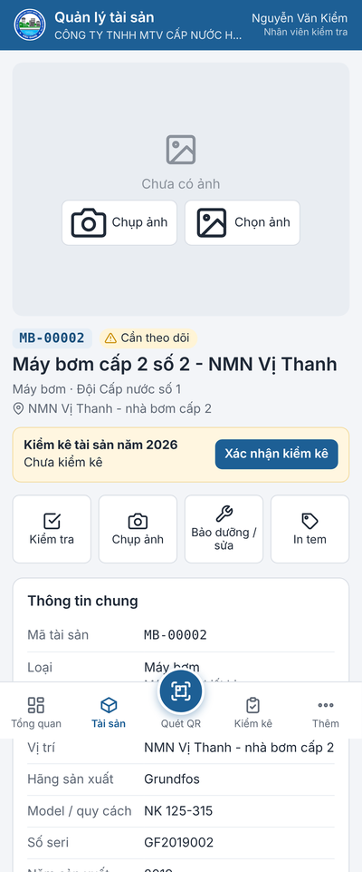
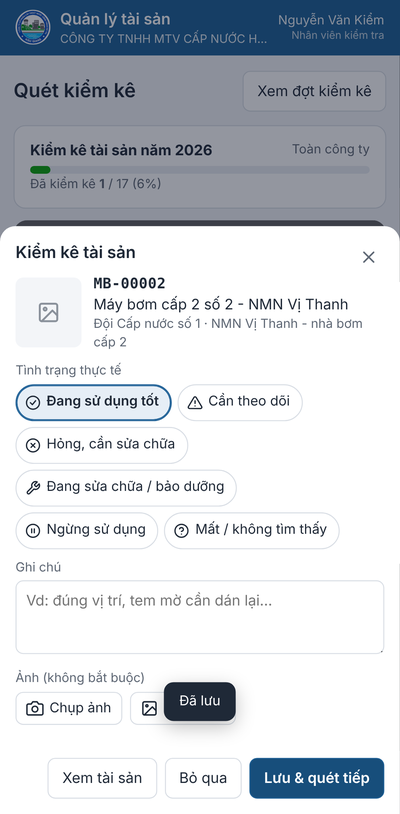

# Phần mềm Quản lý tài sản — quét tem QR xem thông tin, ảnh tài sản

Mỗi tài sản dán 1 tem QR. Quét tem bằng điện thoại → thấy ngay thông tin, ảnh, thông số kỹ thuật, lịch sử kiểm tra / sửa chữa;
ghi kiểm tra, báo hỏng, bảo dưỡng, chụp ảnh tại chỗ; kiểm kê cuối năm bằng quét tem; in tem, nhập / xuất Excel.
Thiết kế chi tiết: [THIET_KE.md](THIET_KE.md).

| Điện thoại: quét tem → trang tài sản | Quét kiểm kê | Máy tính: trang tài sản |
|---|---|---|
|  |  |  |

Thêm: [tổng quan](anh-man-hinh/tong-quan.png) · [in tem QR](anh-man-hinh/in-tem.png) · [tiến độ kiểm kê khi quét](anh-man-hinh/dien-thoai-quet-kiem-ke.png)

## Thư mục

| Tệp | Dùng để |
|---|---|
| `QuanLyTaiSan.exe` | chạy thử trên 1 máy tính (nhấp đúp) |
| `QuanLyTaiSan-GoiCaiDat-IIS\` (và file `.zip` cùng tên) | **gói cài lên máy chủ IIS**: chép sang máy chủ, chạy `CaiDat-IIS.bat` — hướng dẫn chi tiết trong gói: [`HUONG_DAN_CAI_DAT.html`](iis/HUONG_DAN_CAI_DAT.html) |
| `src\`, `web\`, `iis\` | mã nguồn: máy chủ C#, giao diện web, script cài IIS |
| `build.bat` | biên dịch lại trên Windows (tạo `QuanLyTaiSan.exe`, thư mục và file zip gói cài) |

Cần .NET Framework 4.5 trở lên (có sẵn trong Windows 10/11, Windows Server 2016 trở lên).

## Chạy thử trên máy tính

1. Nhấp đúp `QuanLyTaiSan.exe`. Lần đầu cửa sổ đen hỏi **tên và mật khẩu quản trị** — gõ rồi Enter.
2. Trình duyệt tự mở `http://localhost:18090`. Đăng nhập. Dữ liệu nằm trong thư mục `DuLieu` cạnh file .exe.
3. Đóng cửa sổ đen là dừng phần mềm.

Chạy thử chỉ dùng trên chính máy đó. Để điện thoại quét được bằng camera trong trang web phải cài lên máy chủ IIS (có https).
(`QuanLyTaiSan.exe --lan` cho máy khác trong mạng nội bộ vào bằng http để xem thử — không mã hoá, camera trong trang không chạy.)

## Cài lên máy chủ IIS (dùng thật)

Chép thư mục `QuanLyTaiSan-GoiCaiDat-IIS` (hoặc file zip, giải nén) sang máy chủ đang chạy phần mềm Thất thoát nước, nhấp đúp `CaiDat-IIS.bat`.
Cổng 8080 đã có site Thất thoát nước thì phần mềm được cài thành **ứng dụng con** `https://<máy chủ>:8080/taisan/` (dùng chung chứng chỉ).
Script hỏi tài khoản quản trị, in ra địa chỉ. Hướng dẫn từng bước (cài IIS, Hosting Bundle, chứng chỉ, mở cổng, sao lưu, cập nhật, xử lý lỗi):
`HUONG_DAN_CAI_DAT.html` trong gói.

Sau khi cài, đăng nhập quản trị → **Cài đặt** → *Địa chỉ in trong mã QR* = địa chỉ điện thoại dùng để vào, vd `https://tenmien.vn:8080/taisan`.

## Bắt đầu sử dụng

1. **Danh mục**: đã có sẵn 13 loại tài sản của ngành nước (máy bơm, tủ điện – biến tần, máy phát, thiết bị xử lý nước, thuỷ lượng kế,
   van – trụ cứu hoả, đường ống, giếng khoan, nhà trạm – bể chứa, xe, thiết bị văn phòng, dụng cụ, khác) với tiền tố mã, số năm khấu hao,
   chu kỳ bảo dưỡng, thông số kỹ thuật riêng; và các phòng ban, Đội cấp nước số 1–6. Bấm vào dòng để sửa, thêm cho đúng thực tế công ty.
2. **Đưa tài sản vào**:
   - **Nhập từ Excel**: tải file mẫu, hoặc dùng luôn file sổ tài sản cố định đang có — phần mềm tự nhận các cột theo tiêu đề
     (Mã tài sản, Tên tài sản, Loại, Đơn vị, Vị trí, Hãng, Model, Số seri, Năm sản xuất, Ngày đưa vào sử dụng, Nguyên giá, Số năm khấu hao,
     Tình trạng, Ghi chú, các cột thông số như "Công suất (kW)"…). Xem trước số dòng thêm / cập nhật / lỗi rồi mới bấm Nhập.
     Dòng có mã đã có = cập nhật (ô trống giữ nguyên). Loại / đơn vị chưa có được tạo mới.
   - **Thêm tài sản**: điền thông tin, bấm *Vị trí hiện tại* để lấy toạ độ GPS, chụp ảnh ngay.
3. **In tem QR** (xem mục dưới), dán lên tài sản.
4. **Tài khoản**: tạo tài khoản cho nhân viên với quyền phù hợp (bảng dưới).

## In tem QR

Trang **Tài sản** → lọc (vd theo đơn vị) hoặc đánh dấu chọn từng tài sản → **In tem**. Hoặc nút **In tem** trên trang 1 tài sản.

- Chọn **mẫu tem**: giấy decal A4 24 tem (70 × 37 mm), 40 tem, 12 tem lớn, 65 tem nhỏ, hoặc máy in tem cuộn 50 × 30 / 60 × 40 mm.
- Bật / tắt tên công ty, tên tài sản, đơn vị, dòng hướng dẫn. **Bỏ qua ô đầu tờ** khi tờ decal đã dùng dở.
- **Mức chống bẩn / xước**: tem ngoài trời, dễ bẩn chọn *Cao* hoặc *Rất cao*.
- Bấm **In** → hộp thoại in của trình duyệt: chọn máy in, khổ giấy đúng mẫu, tỷ lệ **100%** (không "vừa trang"), lề **không**.
- **Tem trắng**: mở mục *In tem trắng*, chọn loại, số tem → phần mềm cấp trước dãy mã (vd MB-00031 … MB-00054) và đưa vào trang in.
  Dán tem lên tài sản ngoài hiện trường, sau đó quét tem → **Khai báo tài sản với mã này** → điền, chụp ảnh, lấy GPS tại chỗ.

Tem ngoài trời / nơi ẩm (máy bơm giếng, van, trụ cứu hoả): dùng decal PVC phủ màng chống UV, hoặc đặt làm tem nhôm / inox khắc laser
theo đúng mã in ra.

## Quét tem trên điện thoại

Mở địa chỉ máy chủ bằng Chrome (iPhone: Safari), đăng nhập, menu ⋮ → **Thêm vào màn hình chính** để mở như app.

- Nút tròn **Quét QR** ở giữa thanh dưới → đưa tem vào khung; đọc được thì máy rung và mở trang tài sản.
  Chỗ tối bấm **Đèn** (nếu máy hỗ trợ). Không mở được camera: bấm **Chụp ảnh mã QR**, hoặc gõ mã vào ô bên dưới.
- Hoặc dùng **ứng dụng Camera** có sẵn của điện thoại quét tem: tem chứa địa chỉ trang tài sản nên mở thẳng trong trình duyệt.
- Lần đầu trình duyệt hỏi quyền **Camera** (và **Vị trí** khi ghi GPS): chọn *Cho phép*.

## Trang tài sản

- **Ảnh**: bấm ảnh để xem toàn màn hình (vuốt / phím ← → để chuyển, *Tải về*). *Chụp ảnh* / *Thêm ảnh* để bổ sung; cán bộ quản lý đặt
  ảnh chính hoặc bỏ ảnh khỏi bộ ảnh. Điện thoại tự thu nhỏ ảnh trước khi gửi (nhẹ, gửi nhanh qua 4G).
- **Kiểm tra**: chọn tình trạng (tốt, cần theo dõi, hỏng…), ghi chú, ảnh (có thể đưa vào bộ ảnh), *Ghi vị trí GPS*.
  Báo hỏng = kiểm tra với tình trạng *Hỏng, cần sửa chữa* — hiện ngay ở Tổng quan.
- **Bảo dưỡng / sửa**: ngày, nội dung, chi phí, tình trạng sau khi làm, ảnh. Hạn bảo dưỡng tự tính lại theo chu kỳ.
- **Sửa thông tin**, **Điều chuyển** (đơn vị, vị trí, người sử dụng), **Thanh lý** (số quyết định, giá trị thu hồi), **Xoá** (quản trị).
- **Lịch sử**: mọi lần khai báo, sửa (ghi rõ trường nào đổi từ gì sang gì), kiểm tra, bảo dưỡng, điều chuyển, kiểm kê, thêm ảnh — có ảnh, vị trí.
- Giá trị còn lại, khấu hao luỹ kế là **tạm tính** theo đường thẳng để tham khảo; số chính thức theo sổ kế toán.

## Kiểm kê

1. **Kiểm kê** → **Mở đợt kiểm kê**: tên đợt, thời gian, phạm vi (không chọn đơn vị = toàn công ty). Phần mềm chốt **sổ sách** = các tài sản
   đang quản lý của phạm vi tại lúc mở đợt.
2. Tổ kiểm kê bấm **Quét kiểm kê**: quét tem → tờ xác nhận hiện ra (ảnh, mã, tên, đơn vị) → chọn tình trạng thực tế, ghi chú, ảnh nếu cần →
   **Lưu & quét tiếp**. Thanh tiến độ cập nhật ngay. Trên trang tài sản cũng có nút *Xác nhận kiểm kê*.
3. Theo dõi trong trang đợt: tiến độ từng đơn vị (bấm để lọc), tab **Chưa kiểm** (chưa tìm thấy), **Đã kiểm**, **Ngoài sổ**
   (quét được nhưng không có trong sổ sách của đợt). Tài sản khai báo thêm trong lúc kiểm kê: *Bổ sung tài sản mới khai báo vào sổ*.
4. **Biên bản Excel**: danh sách theo đơn vị — theo sổ sách / thực tế / chênh lệch, tình trạng, người kiểm, thời gian, ghi chú; tổng hợp;
   chữ ký người lập biểu – kế toán trưởng – giám đốc (tên lấy ở Cài đặt); trang tiến độ theo đơn vị.
5. **Kết thúc đợt** khi xong (mở lại được).

## Tổng quan, xuất Excel

- **Tổng quan**: số tài sản, nguyên giá, giá trị còn lại, hỏng / đang sửa, đến hạn bảo dưỡng (7 ngày), chưa kiểm tra lâu, chưa có ảnh —
  bấm từng ô / từng thanh biểu đồ để ra danh sách tương ứng.
- Trang **Tài sản** → **Xuất Excel**: xuất đúng danh sách đang lọc (hoặc các tài sản đã chọn), có tổng nguyên giá, khấu hao, giá trị còn lại.

## Quyền người dùng

| Quyền | Được làm |
|---|---|
| Chỉ xem | quét QR, xem thông tin / ảnh / lịch sử, xuất Excel |
| Nhân viên kiểm tra | + kiểm tra, báo hỏng, bảo dưỡng / sửa chữa, chụp ảnh, quét kiểm kê |
| Cán bộ quản lý tài sản | + thêm / sửa, điều chuyển, thanh lý, in tem, tem trắng, nhập Excel, mở đợt kiểm kê, thêm loại / đơn vị |
| Quản trị | + xoá, tài khoản, cài đặt |

Tài khoản có thể **giới hạn 1 đơn vị**: chỉ thêm / sửa tài sản của đơn vị đó (kiểm tra, kiểm kê vẫn quét được mọi tài sản).
Mật khẩu ít nhất 6 ký tự; nhập sai 5 lần thì tạm khoá 10 phút. **Khoá** tài khoản khi nhân viên nghỉ việc.

## Dữ liệu và sao lưu

Máy chủ: `C:\QuanLyTaiSanData` (chạy thử: thư mục `DuLieu` cạnh file .exe) — `taisan.xml`, `LichSu\`, `Anh\`, `taikhoan.xml`.
Mỗi ngày tự giữ 1 bản `taisan.xml` trong `SaoLuu` (90 ngày). **Hãy sao lưu cả thư mục** ra ổ / máy khác định kỳ (ảnh và lịch sử chỉ có ở đây).

## Biên dịch lại (khi sửa mã nguồn)

- Windows: chạy `build.bat` (dùng trình biên dịch C# có sẵn trong Windows, không cần Visual Studio). Mã nguồn viết theo C# 5 để dịch được bằng csc.exe này.
- Linux / macOS (để phát triển): `./build.sh` (cần Mono). Chạy thử: `mono QuanLyTaiSan.exe`.
- Sửa giao diện không cần biên dịch lại: đặt biến môi trường `QLTS_WEB` = đường dẫn thư mục `web` rồi chạy `QuanLyTaiSan.exe`.
- `web\jsQR.js` là thư viện đọc QR mã nguồn mở (giấy phép Apache 2.0, `web\jsQR-LICENSE.txt`); phần còn lại viết riêng cho phần mềm.
- File `QuanLyTaiSan.exe` trong thư mục này được biên dịch sẵn bằng Mono; nếu chạy trên Windows báo lỗi, chạy `build.bat` để biên dịch lại.
