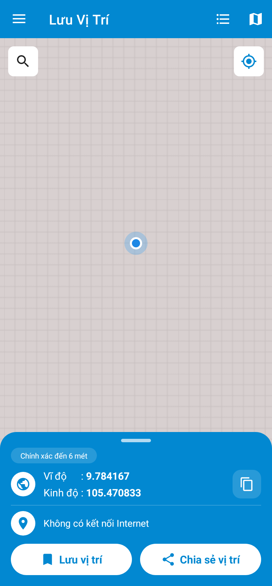
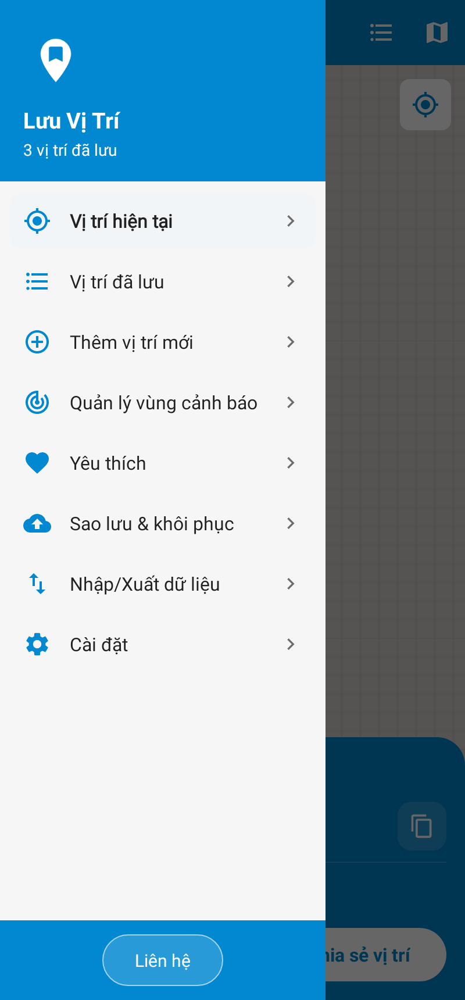
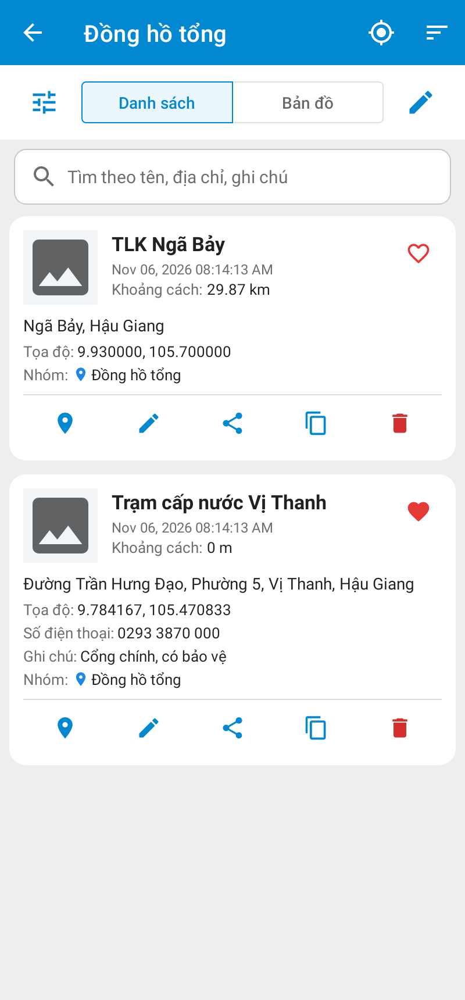
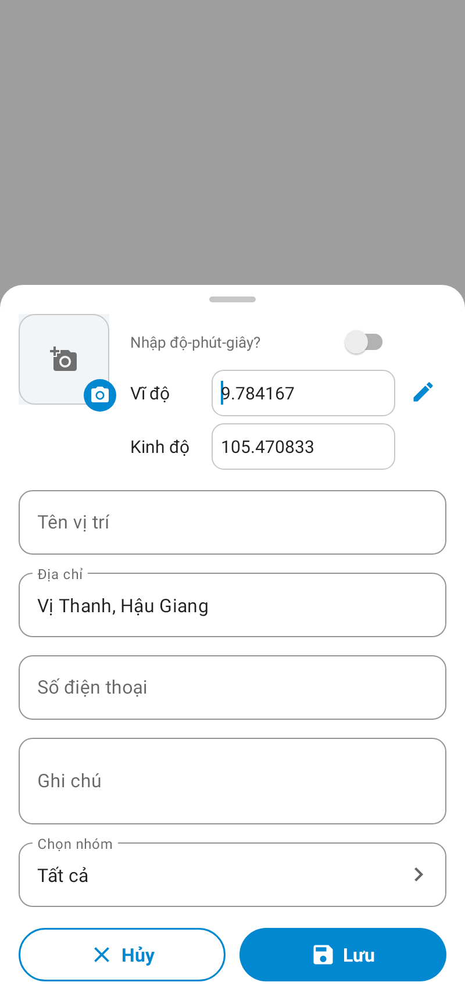

# Lưu Vị Trí – ứng dụng Android lưu, quản lý và chia sẻ vị trí GPS

Viết lại toàn bộ (Kotlin) theo chức năng và bố cục của app "Save Location GPS" v12.7.
Phân tích chi tiết app gốc và đối chiếu từng màn hình: xem [PHAN_TICH_APP_GOC.md](PHAN_TICH_APP_GOC.md).

- **Bộ cài: `LuuViTri-CaiDat.zip`** (Android 7.0 trở lên) — giải nén rồi nhấp đúp:
  - `CaiDat-DienThoai.bat`: cài app lên điện thoại qua cáp USB hoặc Wi-Fi, có hướng dẫn từng bước
    (tự tải công cụ adb, cài / cập nhật giữ dữ liệu, cấp sẵn quyền, tắt tối ưu pin, mở app, cài liên tiếp nhiều máy);
  - `CaiDat-MayChu.bat`: cài máy chủ chia sẻ vị trí trực tiếp trên Windows (tự cài Node.js, tự chạy khi bật máy, mở tường lửa);
  - `HUONG_DAN_CAI_DAT.txt`: hướng dẫn chi tiết, lỗi thường gặp.
  Không có máy tính: gửi `LuuViTri.apk` (trong thư mục `CaiDat`) sang điện thoại rồi mở để cài.
- Không quảng cáo, không cần tài khoản, không cần khoá API; mọi tính năng mở sẵn.
- Giao diện tiếng Việt (theo ngôn ngữ máy) và tiếng Anh; đổi trong Cài đặt → Ngôn ngữ.
- Bản đồ cần Internet. Định vị, vùng cảnh báo dùng Google Play services (máy Android thông thường đều có).

Ảnh chụp giao diện (tạo tự động bằng kiểm thử, bản đồ để trống vì máy kiểm thử không tải ô bản đồ): thư mục [screenshots](screenshots).

| Màn hình chính | Menu | Vị trí đã lưu | Lưu vị trí |
|---|---|---|---|
|  |  |  |  |

## Màn hình chính

- Bản đồ + tấm thông tin màu xanh: độ chính xác, **vĩ độ / kinh độ** (hoặc UTM), nút sao chép, địa chỉ.
- Mặc định chọn vị trí hiện tại. **Nhấn giữ trên bản đồ** để đặt ghim ở vị trí khác. Nút kính lúp: tìm địa điểm
  (gõ tên, hoặc dán tọa độ / link Google Maps). Nút ⌖: về vị trí của tôi.
- Vuốt tấm thông tin xuống để bản đồ rộng hơn, vuốt lên để mở lại.
- **Lưu vị trí**: mở biểu mẫu (ảnh, tọa độ, tên, địa chỉ, SĐT, ghi chú, nhóm). Bật *Chế độ lái xe* thì chạm là lưu ngay.
- **Chia sẻ vị trí**: gửi vị trí hiện tại (kèm link Google Maps / Waze / OpenStreetMap) hoặc chia sẻ trực tiếp.
- Nút trên thanh công cụ: danh sách vị trí đã lưu, kiểu bản đồ (Đường / Vệ tinh / Kết hợp / Địa hình).
- Có thể chia sẻ một link bản đồ từ ứng dụng khác (Google Maps → Chia sẻ → Lưu Vị Trí) để mở đúng vị trí đó.

## Vị trí đã lưu

- *Chế độ nhóm* bật (mặc định): danh sách nhóm "Tất cả – N", từng nhóm có màu. Nút + thêm nhóm;
  nút bút chì: kéo để sắp xếp, sửa / xoá nhóm (xoá nhóm không xoá vị trí).
- Danh sách: tab **Danh sách / Bản đồ**, ô tìm theo tên / địa chỉ / ghi chú, sắp xếp (ngày, khoảng cách, tên),
  nút ☰ chọn thông tin hiển thị trên thẻ, nút bút chì để chọn nhiều và xoá.
- Mỗi thẻ: ♥ yêu thích, xem trên bản đồ, sửa, chia sẻ, sao chép, xoá. Chạm ảnh để xem toàn màn hình.
- Tab Bản đồ: các điểm theo màu nhóm, tự gom cụm; nút ◎ đặt bán kính hiển thị quanh vị trí hiện tại.
- **Xem trên bản đồ**: khoảng cách, vẽ đường đi (khi bật *Chỉ đường*), nút chỉ đường mở Google Maps / Waze / HERE / Sygic.

## Thêm vị trí mới (menu trái)

Nhập tọa độ thập phân hoặc bật **Nhập độ-phút-giây**; nút bút chì cạnh tọa độ để chọn trên bản đồ.

## Vùng cảnh báo (Geofence)

Báo khi **đến gần hoặc rời khỏi** vị trí đã chọn (tối đa 100 vị trí, bán kính 100 m – 5 km).

1. Menu → Quản lý vùng cảnh báo → bật công tắc, chọn **"Luôn cho phép"** vị trí.
2. Nút + → tick các vị trí → nút ◎ chọn bán kính → **Xong**.
3. Bấm "Tối ưu…" và làm theo: tắt tối ưu hóa pin, cho phép thông báo, mở app một lần sau khi khởi động lại máy.

## Nhập / xuất dữ liệu

- Xuất **GPX, KML** (mở bằng Google Earth, OsmAnd…), **CSV** (Excel), **PDF** (danh sách có ảnh), **ảnh** (file .zip).
  File lưu ở **Download/LuuViTri**; Chia sẻ CSV / Xuất PDF mở luôn bảng chia sẻ.
- **Nhập CSV**: cột `location name, latitude, longitude, address, contact number, note, date, group name`
  (giống app gốc – file CSV xuất từ app Save Location cũ nhập được). Có file mẫu; dòng lỗi được liệt kê.
- **Sao lưu & khôi phục** (menu trái): tạo một file `.zip` chứa toàn bộ vị trí, nhóm, ảnh – cất lên Google Drive
  hoặc máy tính; khôi phục bằng cách gộp hoặc thay thế dữ liệu hiện có. Dùng để chuyển sang điện thoại mới.

## Widget và Cài đặt nhanh

- Giữ tay trên màn hình chính → Tiện ích → **Lưu Vị Trí**: 3 loại (Lưu & chia sẻ, Lưu, Chia sẻ).
- Kéo thanh thông báo → sửa ô Cài đặt nhanh → thêm **Lưu nhanh**: một chạm lưu vị trí hiện tại.

## Chia sẻ vị trí trực tiếp

Người nhận mở link trên trình duyệt để xem vị trí của bạn di chuyển theo thời gian thực (30 phút – 8 giờ).
Tính năng này cần một máy chủ nhỏ (app gốc dùng máy chủ của hãng):

1. Cài máy chủ: nhấp đúp `CaiDat-MayChu.bat` trong bộ cài (hoặc làm tay theo [server/README.md](server/README.md)).
2. Trong app: Cài đặt → **Máy chủ vị trí trực tiếp** → nhập địa chỉ, ví dụ `https://vitri.congty.vn`.
3. Chia sẻ vị trí → Vị trí trực tiếp → chọn thời gian → **Bắt đầu chia sẻ trực tiếp** → gửi link.
   Khi đang chia sẻ, tấm thông tin hiện "● Đang chia sẻ trực tiếp" – chạm để xem thời gian còn lại, đổi tần suất, dừng.

## Cài đặt

Đơn vị khoảng cách (km / dặm) · Kiểu chia sẻ (mở bảng chia sẻ trực tiếp hoặc gửi ngay) · Định dạng ngày giờ ·
Chỉ đường · Tự cập nhật GPS · Chế độ lái xe · Chế độ nhóm · Giao diện sáng / tối · Ngôn ngữ ·
Nội dung khi chia sẻ · Định dạng tọa độ DD / DMS / DDM / UTM · App dẫn đường mặc định · Máy chủ vị trí trực tiếp ·
Xoá toàn bộ dữ liệu.

## Đóng gói lại / biên dịch lại từ mã nguồn

Nhấp đúp **`DongGoi.bat`** (Windows, cần Android Studio): build APK release → chép vào `CaiDat\` → tạo
`LuuViTri-CaiDat.zip`. `DongGoi.bat -BoQuaBuild` chỉ đóng gói lại. Linux / macOS: `./donggoi.sh`.


Cần JDK 17+ và Android SDK (platform 35). Cách dễ nhất: mở thư mục `SaveLocation` bằng **Android Studio** → Build → Build APK.
Dòng lệnh (máy đã có Android SDK, đặt `sdk.dir` trong `local.properties` hoặc biến `ANDROID_HOME`):

```bash
cd SaveLocation
./gradlew assembleRelease          # Windows: gradlew.bat assembleRelease
# APK: app/build/outputs/apk/release/app-release.apk
./gradlew testDebugUnitTest        # kiểm thử + ảnh chụp giao diện ở app/build/screenshots
```

- APK được ký bằng `app/debug.keystore` (mật khẩu `android`) đi kèm dự án để mọi máy build ra đều cài đè được.
  Nếu phát hành rộng rãi (Google Play), hãy tạo khoá ký riêng và **không** đưa lên GitHub.
- Email nhận góp ý (Menu → Liên hệ): sửa `support_email` trong `app/src/main/res/values/strings.xml`.

## Cấu trúc mã nguồn

```
app/src/main/java/com/hawasuco/savelocation/
  App.kt                     khởi tạo (giao diện, ngôn ngữ, kênh thông báo)
  data/                      Db (SQLite), Prefs (cài đặt), Models, DataBus
  util/                      Coords (DD/DMS/DDM/UTM), Formats, LocationHelper, GeocoderHelper, MapUtil (OSM),
                             ShareUtil, NavApps, ImageStore, Exporter (CSV/GPX/KML/PDF/ảnh), Backup, Routing, LinkParser
  ui/HomeActivity.kt         khung chính + menu trái
  ui/home, list, groups, geofence, export, backup, settings, live, dialogs, view
  ui/*Activity.kt            Xem trên bản đồ, Đổi vị trí, Tìm kiếm, Camera, Cấp quyền, Nhập CSV, Liên hệ…
  geofence/                  đăng ký vùng cảnh báo, nhận sự kiện, khởi động máy
  live/                      dịch vụ chạy nền + API máy chủ chia sẻ trực tiếp
  widget/                    3 widget + ô Cài đặt nhanh
server/                      máy chủ chia sẻ trực tiếp (Node.js) + trang xem bản đồ
```
