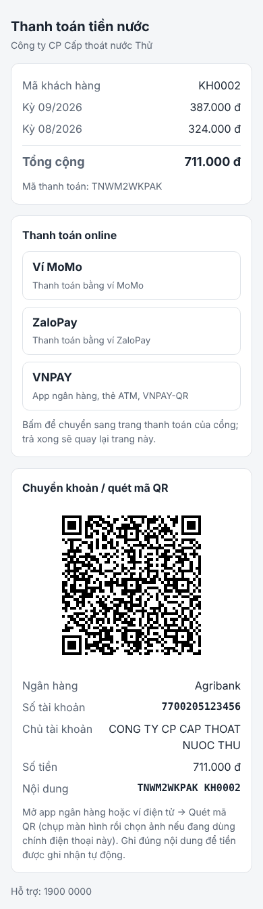

# Kết nối Zalo OA với phần mềm quản lý khách hàng nước EOS

Khách hàng nhắn tin cho Zalo Official Account (OA) của công ty để:

- **liên kết** tài khoản Zalo với mã khách hàng (xác minh bằng 4 số cuối số điện thoại đã đăng ký trong EOS);
- xem **thông tin khách hàng**: tên, địa chỉ, đồng hồ, đối tượng giá, tình trạng;
- xem **lịch sử sử dụng**: chỉ số cũ / mới, m³ tiêu thụ, tiền nước các kỳ gần nhất, bình quân;
- xem **danh sách hoá đơn** (đã / chưa thanh toán) và **nhận file PDF hoá đơn** ngay trong khung chat Zalo;
- **thanh toán** tiền nước qua **Ví MoMo, ZaloPay, VNPAY** (app ngân hàng, thẻ ATM) hoặc **quét mã QR / chuyển khoản**,
  nhận tin xác nhận khi tiền về và tự gạch nợ (tuỳ chọn, xem [Bước 6](#bước-6--thanh-toán-qua-ví-điện-tử--app-ngân-hàng-tuỳ-chọn)).

Thư mục này là **máy chủ trung gian** đứng giữa Zalo và EOS (Node.js, không cần cài thư viện ngoài).

```
 Khách hàng (app Zalo)
        │ nhắn "HD 09/2026"
        ▼
 Máy chủ Zalo ──── webhook HTTPS ────►  Máy chủ trung gian zalo-eos  ──── API (chỉ đọc) ────►  Phần mềm EOS
        ▲                               (Node.js chạy trên IIS)       ◄─── thông tin, hoá đơn ──
        └──── tin trả lời / file PDF ────────────┘
```

Vì sao cần máy chủ trung gian: Zalo không gọi thẳng được vào EOS; EOS vẫn nằm trong mạng nội bộ, chỉ mở API chỉ đọc
cho máy chủ trung gian. Máy chủ trung gian lo xác minh khách hàng, giữ token Zalo, đổi dữ liệu EOS thành tin nhắn.

---

## Cần chuẩn bị

| Hạng mục | Ghi chú |
|---|---|
| **Zalo OA đã xác thực** của công ty | Tài khoản Zalo dùng để cài đặt phải là **quản trị viên** của OA. Kiểm tra gói dịch vụ OA đang dùng có quyền gọi API gửi tin. |
| **Tên miền phụ** cho máy chủ trung gian, vd `zalo.tencongty.vn` | Trỏ về IP công khai của máy chủ, mở cổng **443**. |
| **Chứng chỉ SSL thật** cho tên miền đó | Zalo chỉ gửi webhook tới HTTPS có chứng chỉ hợp lệ — **không dùng được chứng chỉ tự ký** như cổng 8080 của phần mềm Thất thoát nước. Dùng Let's Encrypt miễn phí qua [win-acme](https://www.win-acme.com/). |
| **Máy chủ Windows có IIS + ASP.NET Core Hosting Bundle** | Máy chủ IIS đang chạy phần mềm Thất thoát nước dùng được luôn. Cài thêm **Node.js LTS** (bản 22). |
| **API của EOS** | Nhà cung cấp EOS mở API chỉ đọc (xem Bước 1). Máy chủ trung gian phải gọi tới được EOS (cùng mạng LAN, hoặc qua VPN / cho phép theo IP). |

---

## Bước 1 — Đề nghị nhà cung cấp EOS mở API (chỉ đọc)

Gửi nhà cung cấp EOS danh sách dưới đây. Nếu họ làm **đúng mẫu này** thì máy chủ trung gian chạy được ngay, chỉ cần điền
địa chỉ + khoá vào `.env`. Nếu API của họ đã có sẵn với tên khác, xem mục [Khai báo API EOS](#khai-báo-api-eos) — vẫn nối được,
không phải sửa code (trừ trường hợp hiếm).

| # | API | Trả về |
|---|---|---|
| 1 | `GET /api/khachhang/{maKH}` | Thông tin 1 khách hàng. Không có thì HTTP 404. |
| 2 | `GET /api/khachhang/{maKH}/tieuthu?soKy=6` | Các kỳ gần nhất: kỳ, chỉ số cũ, chỉ số mới, m³ tiêu thụ, tổng tiền. |
| 3 | `GET /api/khachhang/{maKH}/hoadon?soKy=6` | Các hoá đơn gần nhất: số hoá đơn, kỳ, tổng tiền, đã thanh toán chưa, mã tra cứu HĐĐT, link PDF (nếu có). |
| 4 | `GET /api/hoadon/{soHD}/pdf` | File PDF hoá đơn (`application/pdf`), hoặc JSON `{"pdf": "<base64>"}`, hoặc JSON `{"url": "<link PDF>"}`. |
| 5 | (tuỳ chọn) `POST /api/hoadon/{soHD}/thanhtoan` | Ghi nhận thanh toán (gạch nợ) khi tiền về qua cổng thanh toán hoặc chuyển khoản — xem [Bước 6.4](#64-gạch-nợ-trên-eos). Đây là quyền **ghi** duy nhất, cấp riêng. |

Mẫu dữ liệu:

```jsonc
// 1. GET /api/khachhang/KH0001
{ "maKH": "KH0001", "tenKH": "Nguyễn Văn A", "diaChi": "Số 1 Đường ..., Phường ...",
  "soDienThoai": "0901234567", "soSeriDongHo": "DH-0001", "doiTuongGia": "Sinh hoạt", "trangThai": "Đang sử dụng" }

// 2. GET /api/khachhang/KH0001/tieuthu?soKy=6
[ { "ky": "09/2026", "chiSoCu": 3144, "chiSoMoi": 3161, "tieuThu": 17, "tongTien": 153000 },
  { "ky": "08/2026", "chiSoCu": 3125, "chiSoMoi": 3144, "tieuThu": 19, "tongTien": 171000 } ]

// 3. GET /api/khachhang/KH0001/hoadon?soKy=6
[ { "soHoaDon": "0001300", "ky": "09/2026", "tongTien": 153000, "daThanhToan": false,
    "maTraCuu": "AB12CD34", "linkPdf": "" } ]
```

Yêu cầu thêm với nhà cung cấp EOS:

- **Chỉ đọc**: tài khoản / khoá API riêng cho Zalo, không có quyền sửa, xoá.
- **Xác thực**: khoá API (header `Authorization: Bearer …` hoặc `X-API-Key: …`), hoặc tài khoản đăng nhập lấy token — loại nào cũng dùng được.
- **Giới hạn IP**: EOS chỉ nhận yêu cầu từ IP máy chủ trung gian. Nếu EOS ở ngoài mạng nội bộ thì bắt buộc HTTPS.
- **Môi trường thử** + tài liệu (Swagger / Postman) + vài mã khách hàng thử.
- **Hoá đơn điện tử**: nếu file PDF nằm ở nhà cung cấp HĐĐT (VNPT, Viettel, MISA…), EOS trả `linkPdf` (link tải PDF)
  hoặc `maTraCuu` — máy chủ trung gian tự tải PDF nếu link là file PDF, còn link trang tra cứu thì gửi link cho khách.

> EOS không có API và nhà cung cấp chỉ cho đọc cơ sở dữ liệu (vd view chỉ đọc trên SQL Server): vẫn làm được, nhưng phải viết
> lại 4 hàm trong `src/eos.js` để đọc SQL (cài thêm thư viện `mssql`). Nên ưu tiên đề nghị API.

---

## Bước 2 — Tạo ứng dụng trên Zalo for Developers

Làm tại <https://developers.zalo.me>, đăng nhập bằng tài khoản Zalo **quản trị viên OA**
(tên các mục trên trang có thể khác đôi chút theo phiên bản giao diện của Zalo):

1. **Tạo ứng dụng mới** (tên vd "Tra cứu tiền nước"). Mở ứng dụng → **Cài đặt / Thông tin ứng dụng**: chép
   **ID ứng dụng** → `ZALO_APP_ID`, **Khóa bí mật của ứng dụng** → `ZALO_SECRET_KEY`.
2. Thêm sản phẩm **Official Account** → **Thiết lập chung**:
   - **Official Account Callback Url**: `https://zalo.tencongty.vn/zalo/callback`
   - Chọn các quyền: **gửi tin và thông báo qua OA**, **quản lý thông tin người dùng**, **tải lên tệp / hình ảnh**.
3. Mục **Webhook**: chép **OA Secret Key** → `ZALO_OA_SECRET_KEY`. (URL webhook điền ở Bước 4, khi máy chủ đã chạy.)

---

## Bước 3 — Cài máy chủ trung gian

### 3.1. Chạy thử trên máy tính (chưa cần Zalo, chưa cần EOS)

Cài [Node.js LTS](https://nodejs.org/), mở cmd tại thư mục `zalo-eos`:

```bat
copy .env.example .env
npm test
npm run thu
```

`npm test` chạy bộ kiểm tra tự động. `npm run thu` mở khung chat giả lập: gõ như khách nhắn OA, dùng dữ liệu mẫu (`EOS_CHE_DO=mau`):

```
> DK KH0001 4567
> TT
> LS
> HD
> HD 09/2026          (file PDF mẫu lưu vào du-lieu\thu\)
```

### 3.2. Nối API EOS thật

Trong `.env`: `EOS_CHE_DO=api`, điền `EOS_URL`, cách xác thực (`EOS_XAC_THUC`, `EOS_KHOA` …) và các `EOS_DUONG_…` theo tài liệu API EOS
(xem [Khai báo API EOS](#khai-báo-api-eos)). Rồi chạy lại `npm run thu` với **mã khách hàng thật**:

```bat
npm run thu "DK <mã KH thật> <4 số cuối SĐT>" TT LS HD
```

Thấy đúng tên, địa chỉ, chỉ số, tiền → đã nối đúng EOS. Báo lỗi thì xem dòng lỗi (in rõ địa chỉ API và mã lỗi HTTP).

### 3.3. Đưa lên IIS

1. Cài **Node.js LTS** lên máy chủ (mở cmd gõ `where node`, thường là `C:\Program Files\nodejs\node.exe`).
2. Chép thư mục `zalo-eos` (gồm `src`, `public`, `package.json`, `.env`) vào `C:\inetpub\ZaloEos`.
   Chép `iis\web.config` ra **thư mục gốc**: `C:\inetpub\ZaloEos\web.config`.
3. Tạo thư mục dữ liệu và thư mục nhật ký, cấp quyền cho app pool (cmd quyền Administrator):

   ```bat
   mkdir C:\ZaloEosData
   mkdir C:\inetpub\ZaloEos\logs
   ```

4. **IIS Manager → Application Pools → Add**: tên `ZaloEos`, **.NET CLR version: No Managed Code**.
   Advanced Settings: **Start Mode = AlwaysRunning**, **Idle Time-out = 0** (để máy chủ luôn chạy, token Zalo luôn được làm mới).
5. Cấp quyền:

   ```bat
   icacls C:\ZaloEosData /grant "IIS AppPool\ZaloEos:(OI)(CI)M"
   icacls C:\inetpub\ZaloEos\logs /grant "IIS AppPool\ZaloEos:(OI)(CI)M"
   icacls C:\inetpub\ZaloEos\.env /inheritance:r /grant "Administrators:F" "SYSTEM:F" "IIS AppPool\ZaloEos:R"
   ```

6. **Sites → Add Website**: tên `ZaloEos`, app pool `ZaloEos`, thư mục `C:\inetpub\ZaloEos`,
   binding **https**, cổng **443**, host name `zalo.tencongty.vn`, tích **Require Server Name Indication**.
7. Lấy chứng chỉ thật: chạy `wacs.exe` (win-acme) → chọn site `ZaloEos` → win-acme tự gắn chứng chỉ và tự gia hạn.
8. Mở `https://zalo.tencongty.vn/` → thấy **"Máy chủ Zalo OA - EOS đang chạy."**
   Lỗi 502.5 / 500.30: kiểm tra đường dẫn `node.exe` trong `web.config`, xem `C:\inetpub\ZaloEos\logs\stdout_*.log`.

> Không dùng IIS: chạy `npm start` (cổng `PORT` trong `.env`) sau một reverse proxy HTTPS bất kỳ cũng được.

---

## Bước 4 — Xác thực tên miền, bật webhook, cấp quyền OA

1. **Xác thực tên miền** (developers.zalo.me → ứng dụng → **Xác thực tên miền**): nhập `zalo.tencongty.vn`, tải file xác thực
   Zalo đưa (dạng `zalo_verifier….html`), chép vào `C:\inetpub\ZaloEos\public\` → bấm **Xác thực**.
2. **Webhook**: URL `https://zalo.tencongty.vn/zalo/webhook`. Bật các sự kiện:
   - **Người dùng gửi tin nhắn văn bản** (`user_send_text`) — bắt buộc;
   - **Người dùng quan tâm OA** (`follow`), **bỏ quan tâm OA** (`unfollow`);
   - (tuỳ chọn) gửi hình ảnh, sticker — máy chủ chỉ nhắc cách dùng.
3. **Cấp quyền OA cho máy chủ** (làm 1 lần): mở trình duyệt
   `https://zalo.tencongty.vn/zalo/cap-quyen?khoa=<KHOA_QUAN_TRI>` → đăng nhập Zalo quản trị viên → chọn OA → **Cho phép**
   → trang báo **"Đã cấp quyền"**.
4. Kiểm tra: `https://zalo.tencongty.vn/trang-thai?khoa=<KHOA_QUAN_TRI>` → `"daCapQuyen": true`, `"thieuCauHinh": []`.
5. Ứng dụng Zalo phải ở trạng thái **kích hoạt / đang hoạt động** (không phải chỉ thử nghiệm) để mọi khách dùng được.

---

## Bước 5 — Thử trên điện thoại và gắn menu OA

1. Dùng Zalo trên điện thoại **quan tâm** OA → nhận lời chào. Nhắn `DK <mã KH> <4 số cuối SĐT>`, rồi `TT`, `LS`, `HD`, `HD 09/2026`.
2. Gắn **menu OA** để khách bấm thay vì gõ (trang quản lý OA <https://oa.zalo.me> → **Quản lý → Menu**), mỗi mục chọn hành động
   **gửi tin nhắn** với nội dung:

   | Tên mục | Nội dung gửi |
   |---|---|
   | Thông tin khách hàng | `TT` |
   | Lịch sử dùng nước | `LS` |
   | Hoá đơn tiền nước | `HD` |
   | Thanh toán | `THANH TOAN` |
   | Hướng dẫn | `MENU` |

3. In mã QR của OA và cú pháp `DK <mã KH> <4 số cuối SĐT>` lên hoá đơn / giấy báo tiền nước.

---

## Bước 6 — Thanh toán qua ví điện tử / app ngân hàng (tuỳ chọn)

Khách gửi `THANH TOAN` → OA gửi tin gồm:

- **liên kết trang thanh toán** của khách: nút **Ví MoMo**, **ZaloPay**, **VNPAY** (app ngân hàng, thẻ ATM, VNPAY-QR) — bấm là sang
  cổng, app ví / ngân hàng tự mở, trả xong quay về trang; cổng báo kết quả ngay nên OA nhắn xác nhận gần như tức thì;
- **ảnh mã QR VietQR** + thông tin chuyển khoản vào tài khoản công ty (mọi app ngân hàng, ví có quét VietQR đều dùng được).

Cổng nào / VietQR có khai trong `.env` thì mới hiện. Mỗi lần khách yêu cầu, máy chủ tạo **mã thanh toán riêng** (vd `TN8K2F7QXA`)
gắn với các hoá đơn còn nợ — dùng làm mã đơn gửi cổng và nội dung chuyển khoản, nên tiền về từ kênh nào cũng biết đúng hoá đơn.

```
 Khách: THANH TOAN ─► OA gửi liên kết trang thanh toán + ảnh QR (711.000 đ, mã TN8K2F7QXA)
   ├─ bấm Ví MoMo / ZaloPay / VNPAY ─► máy chủ tạo đơn ở cổng ─► khách trả trong app ─► cổng gọi IPN /cong/<cổng>/ipn (có chữ ký)
   └─ quét QR / chuyển khoản ─► tiền vào TK công ty ─► dịch vụ báo số dư gọi /thanh-toan/webhook
 ─► kiểm chữ ký, số tiền ─► gạch nợ trên EOS (nếu có API) ─► OA nhắn "Đã nhận 711.000 đ qua Ví MoMo…" ─► lưu để đối soát
```



### 6.1. Cổng thanh toán Ví MoMo, ZaloPay, VNPAY

Khai khoá do từng cổng cấp khi ký hợp đồng vào `.env` (chi tiết trong `.env.example`):

| Cổng | Khai trong `.env` | Lấy ở đâu |
|---|---|---|
| Ví MoMo | `MOMO_PARTNER_CODE`, `MOMO_ACCESS_KEY`, `MOMO_SECRET_KEY` | Trang MoMo Business → thông tin tích hợp |
| ZaloPay | `ZALOPAY_APP_ID`, `ZALOPAY_KEY1`, `ZALOPAY_KEY2` | Trang quản lý merchant ZaloPay |
| VNPAY | `VNPAY_TMN_CODE` (vnp_TmnCode), `VNPAY_HASH_SECRET` (vnp_HashSecret) | Email / trang quản lý merchant VNPAY |

Địa chỉ nhận kết quả (máy chủ tự gửi kèm mỗi đơn cho MoMo, ZaloPay):

| Cổng | Báo kết quả (IPN / callback) | Khách quay về |
|---|---|---|
| Ví MoMo | `https://zalo.tencongty.vn/cong/momo/ipn` (POST) | `/cong/momo/ve` |
| ZaloPay | `https://zalo.tencongty.vn/cong/zalopay/ipn` (POST) | `/cong/zalopay/ve` |
| VNPAY | `https://zalo.tencongty.vn/cong/vnpay/ipn` (GET) — **gửi VNPAY nhờ khai IPN URL** cho mã website | `/cong/vnpay/ve` |

Các bước:

1. **Thử trước bằng môi trường sandbox**: dùng bộ khoá thử của từng cổng, để `*_MOI_TRUONG=thu` (mặc định). Khởi động máy chủ,
   nhật ký in "Cổng Ví MoMo: môi trường THỬ…". Nhắn `THANH TOAN` trên Zalo → mở liên kết → bấm từng cổng → trả bằng ví / thẻ thử
   theo tài liệu sandbox của cổng → kiểm tra: OA nhắn xác nhận, `HD` báo đã thanh toán, file đối soát có dòng kênh tương ứng.
2. **Chuyển sang thu tiền thật**: thay bằng khoá thật, đặt `MOMO_MOI_TRUONG=that`, `ZALOPAY_MOI_TRUONG=that`, `VNPAY_MOI_TRUONG=that`,
   recycle app pool. Trang `/trang-thai?khoa=…` hiện môi trường từng cổng (`"cong": {"momo": "thật", …}`).
3. Thử 1 giao dịch nhỏ thật trên mỗi cổng trước khi thông báo cho khách.

Tuỳ chọn: `MOMO_LOAI=payWithMethod` để trang MoMo cho chọn thêm thẻ (nếu hợp đồng cho phép); `VNPAY_MA_NGAN_HANG=VNPAYQR`
(vào thẳng màn hình quét QR) hoặc `VNBANK` (thẻ ATM nội địa) — để trống thì khách chọn trên trang VNPAY.

Máy chủ xử lý kết quả cổng:

- **Mọi kết quả phải đúng chữ ký** của cổng (MoMo, ZaloPay: HMAC-SHA256; VNPAY: HMAC-SHA512); sai thì từ chối, không ghi nhận.
- Cổng gửi lại nhiều lần / khách vừa quay về vừa có IPN: mỗi giao dịch (mã giao dịch của cổng) chỉ ghi nhận 1 lần.
- VNPAY nhận đúng mã phản hồi VNPAY quy định: `00` thành công, `01` không có đơn, `02` đã xác nhận, `04` sai số tiền, `97` sai chữ ký.
- ZaloPay chỉ gọi callback khi đã thu tiền; nếu khách quay về trước khi callback tới, máy chủ hỏi trạng thái đơn ở ZaloPay để ghi nhận ngay.
- Khách đã trả mã thanh toán đó (qua kênh khác) mà vẫn trả tiếp: ghi "cần đối soát" để hoàn tiền, không gạch nợ lần 2.
- Phí giao dịch theo hợp đồng từng cổng; tiền về tài khoản công ty theo lịch quyết toán của cổng.

### 6.2. VietQR — khai tài khoản nhận tiền

Trong `.env` (giải thích chi tiết trong `.env.example`):

```ini
TT_NGAN_HANG_BIN=970405              # mã BIN 6 số của ngân hàng nhận (Agribank 970405, Vietcombank 970436, VietinBank 970415, BIDV 970418…)
TT_TEN_NGAN_HANG=Agribank
TT_SO_TAI_KHOAN=7700xxxxxxxxx
TT_TEN_TAI_KHOAN=CONG TY CP CAP THOAT NUOC ...
```

Nên dùng **1 tài khoản (hoặc tài khoản ảo) riêng cho tiền nước** để dễ đối soát. Thử trên máy:

```bat
npm run thu "DK KH0002 5678" "THANH TOAN"
```

Ảnh QR được lưu trong `du-lieu\thu\` — quét thử bằng app ngân hàng (chưa cần chuyển) để kiểm tra đúng **tên chủ tài khoản**
và số tiền. Giả lập ngân hàng báo tiền về ngay trong khung chat thử: `!ck 711000 <nội dung chuyển khoản>`.

### 6.3. Xác nhận chuyển khoản tự động (nên có nếu dùng VietQR)

Tiền qua cổng (6.1) đã được cổng báo về. Riêng chuyển khoản / quét VietQR cần thêm nguồn báo biến động số dư:

| Cách | Ưu điểm | Lưu ý |
|---|---|---|
| **API của chính ngân hàng nhận tiền** (dịch vụ thông báo biến động số dư / Open API cho doanh nghiệp) | Chính thống, dữ liệu không qua bên thứ ba | Làm việc, ký với ngân hàng; định dạng mỗi ngân hàng một khác, có thể cần chỉnh tên trường |
| **Dịch vụ trung gian** đọc biến động số dư rồi gửi webhook (vd SePay, Casso) | Cài nhanh, hỗ trợ nhiều ngân hàng | Bên thứ ba được xem giao dịch của tài khoản — cân nhắc theo quy định nội bộ; có phí dịch vụ |

Khai trong dịch vụ báo số dư:

- **URL webhook**: `https://zalo.tencongty.vn/thanh-toan/webhook` (POST, JSON);
- **Xác thực**: kiểu API Key → header `Authorization: Apikey <TT_KHOA_WEBHOOK>` (chấp nhận cả `Bearer <khoá>` hoặc chỉ `<khoá>`;
  tên header khác thì đặt `TT_HEADER_WEBHOOK`). Điền cùng khoá đó vào `TT_KHOA_WEBHOOK` trong `.env`.

Máy chủ đọc sẵn dữ liệu kiểu SePay (`id`, `transferType`, `transferAmount`, `content`, `accountNumber`) và kiểu Casso
(`data: [{ tid, amount, description }]`). Dạng khác: thêm tên trường vào danh sách `GD` trong `src/thanhtoan.js`.

Cách xử lý từng khoản tiền về:

| Trường hợp | Máy chủ làm |
|---|---|
| Đủ tiền | Gạch nợ trên EOS (nếu có API), nhắn khách "đã thanh toán". |
| Thừa tiền | Như trên, ghi "thừa" để kế toán trừ kỳ sau / hoàn lại. |
| Thiếu tiền | **Không** gạch nợ; nhắn khách số còn thiếu; ghi "cần đối soát". |
| Chuyển lần 2 cho mã đã trả | **Không** gạch nợ lại; ghi "cần đối soát" để hoàn / trừ kỳ sau. |
| Nội dung không có mã thanh toán | Bỏ qua (giao dịch khác) — kế toán xử lý theo sao kê như hiện nay. |
| Tiền ra, tài khoản khác | Bỏ qua. |
| Dịch vụ báo lặp lại cùng 1 giao dịch | Chỉ xử lý 1 lần. |

Chưa nối báo số dư (`TT_KHOA_WEBHOOK` trống): khách vẫn thanh toán được, OA báo "được ghi nhận sau khi kế toán đối soát".

### 6.4. Gạch nợ trên EOS

Đề nghị nhà cung cấp EOS thêm 1 API ghi thanh toán, vd `POST /api/hoadon/{soHD}/thanhtoan` nhận JSON:

```json
{ "maKH": "KH0002", "soHD": "0001300", "ky": "09/2026", "soTien": 387000,
  "maGiaoDich": "MOMO-4088878653", "thoiGian": "2026-10-12 09:05:00", "kenh": "Ví MoMo" }
```

`kenh` là `Ví MoMo`, `ZaloPay`, `VNPAY` hoặc `Chuyển khoản / VietQR`; `maGiaoDich` là mã giao dịch của cổng / ngân hàng.

EOS phải **bỏ qua nếu `maGiaoDich` đã ghi** (gọi lại không ghi 2 lần). Khai `EOS_DUONG_GHI_THANH_TOAN=POST /api/hoadon/{soHD}/thanhtoan`.
Chưa có API này: kế toán gạch nợ tay theo file đối soát.

### 6.5. Đối soát

Mở `https://zalo.tencongty.vn/thanh-toan/doi-soat?khoa=<KHOA_QUAN_TRI>&tu=2026-10-01&den=2026-10-31` → tải file Excel:
thời gian nhận, **kênh** (Ví MoMo / ZaloPay / VNPAY / chuyển khoản), mã giao dịch (của cổng hoặc ngân hàng), mã thanh toán, mã KH, kỳ,
số tiền hoá đơn, số tiền nhận, chênh lệch, trạng thái, kết quả gạch nợ EOS, nội dung chuyển khoản / mã đơn. Bỏ `tu` / `den` để lấy
tất cả. Đối chiếu với báo cáo đối soát mà từng cổng gửi hằng ngày.

### 6.6. Kênh thu hộ đang có

Công ty đã có hợp đồng **thu hộ** với ngân hàng / ví điện tử (khách vào app → Thanh toán hoá đơn → Nước → nhập mã KH) thì khai
`TT_THU_HO` để OA hướng dẫn thêm cách này (`{maKH}` tự thay bằng mã của khách). Chưa khai cổng (6.1) và tài khoản nhận tiền (6.2)
thì lệnh `THANH TOAN` chỉ hiện hướng dẫn thu hộ.

---

## Khách hàng dùng thế nào

Gõ có dấu hay không dấu, hoa hay thường đều được (vd `đk kh0001 4567`, `Hóa đơn 9/2026`, `tra cứu hoá đơn`).

| Khách gửi | OA trả lời |
|---|---|
| `DK KH0001 4567` | Liên kết mã KH0001 nếu 4 số cuối SĐT trong hồ sơ EOS là 4567 (gõ đủ số điện thoại cũng được). Mỗi tài khoản Zalo liên kết tối đa 5 mã. |
| `TT` (thông tin, tra cứu) | Thông tin các mã đã liên kết (số điện thoại được che: 090\*\*\*\*567). |
| `LS` (lịch sử) — `LS KH0002` | Lịch sử chỉ số, m³, tiền các kỳ gần nhất + bình quân. Liên kết nhiều mã thì thêm mã sau lệnh. |
| `HD` (hoá đơn) | Danh sách hoá đơn gần nhất: số tiền, đã / chưa thanh toán. |
| `HD 09/2026` | Gửi file PDF hoá đơn kỳ 09/2026. |
| `THANH TOAN` (đóng tiền, QR) | Liên kết trang thanh toán (Ví MoMo, ZaloPay, VNPAY) + mã QR chuyển khoản cho **tất cả hoá đơn còn nợ** của 1 mã KH. |
| `THANH TOAN 09/2026` | Như trên, cho riêng hoá đơn kỳ 09/2026. |
| `HUY` — `HUY KH0001` | Huỷ tất cả liên kết / huỷ 1 mã. |
| `MENU` hoặc `?` | Hướng dẫn. |
| Tin khác (vd "nhà tôi bị mất nước") | Nhắc menu tối đa 1 lần / 30 phút; tin vẫn nằm trong hộp thư OA để nhân viên CSKH trả lời như bình thường. |

Ví dụ:

```
Khách:  HD 09/2026
OA:     Hoá đơn kỳ 09/2026 – mã KH0001: 153.000 đ – chưa thanh toán
OA:     [file đính kèm] HoaDon_KH0001_09-2026.pdf

Khách:  thanh toán
OA:     THANH TOÁN TIỀN NƯỚC – mã KH0001
        Kỳ 09/2026: 153.000 đ
        Tổng cộng: 153.000 đ
        Cách 1 – Thanh toán online qua Ví MoMo, ZaloPay, VNPAY (VNPAY: app ngân hàng, thẻ ATM) – bấm:
        https://zalo.tencongty.vn/tt/…
        Cách 2 – Quét mã QR … Cách 3 – Chuyển khoản: … Nội dung: TN8K2F7QXA KH0001
OA:     [ảnh] mã QR
        … (khách bấm liên kết → Ví MoMo → xác nhận trong app MoMo) …
OA:     Đã nhận 153.000 đ qua Ví MoMo – mã KH KH0001 (mã giao dịch MOMO-4088878653).
        Hoá đơn kỳ 09/2026 đã được thanh toán. Cảm ơn quý khách!
```

---

## Khai báo API EOS

Tất cả trong `.env`:

- `EOS_URL`: địa chỉ gốc, vd `http://10.0.0.5:8080`.
- `EOS_DUONG_KHACH_HANG`, `EOS_DUONG_LICH_SU`, `EOS_DUONG_HOA_DON`, `EOS_DUONG_TAI_HOA_DON`: đường dẫn từng API, có tham số
  `{maKH}` `{soKy}` `{soHD}` `{ky}` `{thang}` `{nam}` `{maTraCuu}`. Mặc định là GET; API cần POST thì viết
  `POST /api/tracuu` — các tham số được gửi dạng JSON (`{"maKH": "...", ...}`). Không có API tải PDF thì ghi `khong`.
  Ví dụ: `EOS_DUONG_TAI_HOA_DON=/api/hoadon/pdf?ma={maKH}&thang={thang}&nam={nam}`.
- `EOS_XAC_THUC`: `bearer` / `header` / `basic` / `dangnhap` / `khong` (giải thích trong `.env.example`).

Máy chủ tự hiểu:

- **lớp bọc** hay gặp: `{ "success": true, "data": ... }`, `{ "result": ... }`, `{ "d": ... }` (ASP.NET), danh sách nằm trong `items` / `rows` …;
- **tên trường** thường gặp, không phân biệt hoa thường, bỏ qua `_`: vd mã KH là `maKH`, `MaKhachHang`, `MaDanhBo`, `danh_bo`,
  `customerCode` …; kỳ là `ky`, `KyHoaDon`, `thangNam` hoặc cặp `Thang` + `Nam`; kỳ dạng `09/2026`, `2026-09`, `202609` đều được;
- **số** dạng `153000`, `"153.000"`, `"153,000"`; **thanh toán** dạng `true/false`, `1/0`, `"Đã thu"`, `"Chưa thanh toán"`;
- `{ "success": false, "message": "Không tìm thấy..." }` hoặc HTTP 404 = không có khách hàng.

API EOS dùng tên trường lạ hơn (vd tên khách là `TenChuHo`): mở `src/eos.js`, thêm tên đó vào **đầu** danh sách tương ứng
trong `TRUONG` (vd `ten: ['TenChuHo', 'tenKH', ...]`), chạy lại `npm run thu` để kiểm tra.

---

## Cách hoạt động (cho cán bộ IT)

| File | Việc |
|---|---|
| `src/server.js` | Máy chủ HTTP: nhận webhook Zalo và webhook ngân hàng, kiểm chữ ký / khoá, trang cấp quyền, liên kết tải tạm, đối soát, trạng thái. |
| `src/zalo.js` | Gọi Zalo OA API: OAuth v4 + PKCE, tự làm mới token, gửi tin tư vấn (`/v3.0/oa/message/cs`), tải file / ảnh lên (`/v2.0/oa/upload/file`, `/v2.0/oa/upload/image`) rồi gửi. |
| `src/eos.js` | Lớp nối EOS: chế độ `mau` (dữ liệu mẫu) và `api` (REST/JSON). |
| `src/hoithoai.js` | Kịch bản trò chuyện: hiểu lệnh, xác minh khách, định dạng tin trả lời. |
| `src/thanhtoan.js` | Thanh toán: tạo mã thanh toán + QR, nhận báo tiền về (cổng, ngân hàng), gạch nợ EOS, nhắn xác nhận, file đối soát. |
| `src/congthanhtoan.js` | Ví MoMo (API v2), ZaloPay (API v2), VNPAY (2.1.0): tạo đơn, kiểm chữ ký IPN / callback / trang về. |
| `src/trangthanhtoan.js` | Trang thanh toán khách mở từ Zalo (`/tt/<khoá>`). |
| `src/vietqr.js`, `src/qrcode.js` | Chuỗi VietQR (chuẩn EMVCo / NAPAS) và vẽ mã QR ra ảnh PNG — không cần thư viện, không gửi dữ liệu ra ngoài. |
| `src/xlsx.js` | Ghi file Excel đối soát. |
| `src/thu.js` | Khung chat giả lập (`npm run thu`), có giả lập ngân hàng báo tiền về (`!ck`). |
| `test/` | Kiểm tra tự động (`npm test`). |

- **Token Zalo**: access token hạn khoảng 25 giờ, refresh token hạn 3 tháng và **mỗi refresh token chỉ dùng được 1 lần**.
  Máy chủ tự làm mới (kiểm mỗi giờ, và khi Zalo báo token hỏng), ghi ngay token mới vào `C:\ZaloEosData\zalo-token.json`.
  Chỉ phải cấp quyền lại (Bước 4.3) khi: máy chủ ngừng chạy quá 3 tháng, mất file token, hoặc OA gỡ quyền ứng dụng.
- **Dữ liệu lưu trên máy chủ trung gian**: `lien-ket.json` (Zalo user id ↔ mã KH), token, `ma-thanh-toan.json` (mã thanh toán ↔
  hoá đơn, giữ 180 ngày), `giao-dich.json` (khoản tiền đã nhận, giữ 400 ngày). Thông tin khách hàng, chỉ số, hoá đơn
  **không lưu lại**, lần nào cũng hỏi EOS — EOS sửa gì khách thấy ngay.
- **Gửi file**: PDF ≤ 5 MB tải lên Zalo rồi gửi dạng file. Zalo không nhận (file lớn, lỗi) thì gửi **liên kết tải tạm**
  `https://zalo.tencongty.vn/tai/<mã ngẫu nhiên>`, dùng được 30 phút. Ảnh QR (≤ 1 MB) cũng vậy.
- Zalo chỉ cho OA gửi **tin tư vấn** trong một khoảng thời gian sau khi khách nhắn / tương tác (theo chính sách tin nhắn OA hiện hành).
  Máy chủ chỉ trả lời ngay khi khách nhắn nên luôn nằm trong khoảng đó.

---

## Bảo mật và dữ liệu cá nhân

- Chỉ chủ hồ sơ mới xem được: liên kết cần **mã KH + số điện thoại trong hồ sơ EOS**. Sai mã hay sai số đều nhận cùng 1 câu trả lời
  (không dò được mã nào tồn tại); sai 5 lần thì khoá đăng ký 30 phút.
- Khi gửi `DK`, khách được báo rõ mục đích dùng dữ liệu (đồng ý theo Nghị định 13/2023/NĐ-CP về bảo vệ dữ liệu cá nhân);
  `HUY` huỷ bất cứ lúc nào; khách **bỏ quan tâm OA** thì liên kết tự xoá.
- Sự kiện webhook phải đúng chữ ký `X-ZEvent-Signature` (OA Secret Key) mới được xử lý. Trang cấp quyền / trạng thái cần `KHOA_QUAN_TRI`.
- API EOS chỉ đọc, chỉ nhận IP máy chủ trung gian, không mở ra Internet (riêng API gạch nợ là quyền ghi, cấp riêng).
- Thanh toán: báo tiền về chỉ được nhận khi đúng `TT_KHOA_WEBHOOK`; chỉ tính tiền **vào** đúng tài khoản đã khai; chỉ gạch nợ khi
  **đủ số tiền** và mã thanh toán chưa trả; mã thanh toán ngẫu nhiên, không đoán được. Ảnh QR tạo ngay trên máy chủ,
  không gửi số tài khoản / số tiền cho dịch vụ tạo QR bên ngoài.
- `.env` (khoá bí mật) và thư mục dữ liệu (token, liên kết) đã có trong `.gitignore` — **không bao giờ** đưa lên GitHub.
  Lỡ lộ `ZALO_SECRET_KEY` / `ZALO_OA_SECRET_KEY`: đổi khoá trên developers.zalo.me, sửa `.env`, cấp quyền lại.

---

## Mở rộng sau

- **Chủ động gửi thông báo tiền nước hằng tháng**: dùng **ZNS** (Zalo Notification Service) — gửi theo số điện thoại kể cả khi
  khách chưa nhắn OA. Cần đăng ký mẫu tin ZNS (Zalo duyệt), tính phí theo tin. EOS xuất danh sách hoá đơn kỳ mới → gọi API ZNS.
- **Liên kết bằng số điện thoại Zalo**: gửi tin "yêu cầu chia sẻ thông tin", khách bấm đồng ý → Zalo gửi số điện thoại về
  (sự kiện `user_submit_info`) → tìm khách hàng theo SĐT (cần thêm API tìm theo SĐT bên EOS).
- **Hoàn tiền tự động** qua API hoàn tiền của MoMo / ZaloPay / VNPAY cho các khoản "trả trùng" (hiện kế toán xử lý theo file đối soát).
- **Nhắc nợ**: kết hợp ZNS gửi hoá đơn kèm câu "gửi THANH TOAN cho OA để nhận mã QR".

---

## Xử lý sự cố

Nhật ký máy chủ: `C:\inetpub\ZaloEos\logs\stdout_*.log`.

| Hiện tượng / dòng nhật ký | Cách xử lý |
|---|---|
| Không lưu được URL webhook trên developers.zalo.me | Máy chủ phải đang chạy, URL là HTTPS có chứng chỉ thật, tên miền đã xác thực. |
| `Từ chối sự kiện webhook: sai chữ ký` | `ZALO_OA_SECRET_KEY` / `ZALO_APP_ID` trong `.env` chưa đúng với ứng dụng. Sửa `.env` rồi recycle app pool. |
| `Chưa cấp quyền Zalo OA` | Làm Bước 4.3. |
| `Zalo không cấp token … refresh token` | Refresh token hết hạn / OA đã gỡ quyền: làm lại Bước 4.3. |
| `Zalo báo lỗi -216` lặp lại | Token không còn hiệu lực: làm lại Bước 4.3. |
| `Không gọi được EOS …` | Máy chủ trung gian không tới được EOS: kiểm tra mạng / VPN / tường lửa, IP đã được EOS cho phép chưa. |
| `EOS trả lỗi HTTP 401 / 403` | Sai khoá API / tài khoản EOS. |
| Khách báo "không khớp với hồ sơ" dù gõ đúng | Hồ sơ EOS chưa có / sai số điện thoại → CSKH cập nhật số trong EOS. |
| Khách nhận liên kết thay vì file | Zalo không nhận file (vd lớn hơn 5 MB); liên kết vẫn tải được trong 30 phút. Cần `URL_CONG_KHAI` đúng. |
| Bấm nút cổng báo "Chưa mở được cổng thanh toán" | Xem nhật ký dòng `Không tạo được đơn …`: sai khoá, dùng khoá thật mà `*_MOI_TRUONG=thu` (hoặc ngược lại), số tiền dưới mức tối thiểu của cổng. |
| Đã trả qua cổng mà không nhận xác nhận | Kết quả cổng không tới máy chủ: kiểm tra `URL_CONG_KHAI`, HTTPS, VNPAY đã khai IPN URL chưa. Nhật ký `IPN MoMo: sai_chu_ky` → sai `MOMO_SECRET_KEY`; `IPN VNPAY` trả 97 → sai `VNPAY_HASH_SECRET`; ZaloPay `mac not equal` → sai `ZALOPAY_KEY2`. |
| Quét QR báo không đọc được / sai tên chủ tài khoản | App / ví đó chưa hỗ trợ VietQR → khách dùng Cách 2 (chuyển khoản tay). Sai tên chủ tài khoản → sai `TT_NGAN_HANG_BIN` hoặc `TT_SO_TAI_KHOAN`. |
| `Từ chối báo thanh toán: sai khoá` | Khoá khai trong dịch vụ báo số dư khác `TT_KHOA_WEBHOOK`, hoặc dịch vụ dùng header khác (`TT_HEADER_WEBHOOK`). |
| Tiền đã về nhưng khách không nhận xác nhận | Khách sửa / xoá nội dung chuyển khoản (không có mã thanh toán) → kế toán xử lý theo sao kê. Hoặc Zalo không cho gửi tin tư vấn lúc đó → xem nhật ký; giao dịch vẫn nằm trong file đối soát. |
| `Lỗi ghi EOS: …` | API gạch nợ EOS lỗi — giao dịch vẫn được lưu; kế toán gạch nợ tay theo file đối soát rồi báo nhà cung cấp EOS. |
| IIS báo 502.5 / 500.30 | Sai đường dẫn `node.exe` trong `web.config`, hoặc app pool không đọc được thư mục site / ghi được `C:\ZaloEosData`. |
